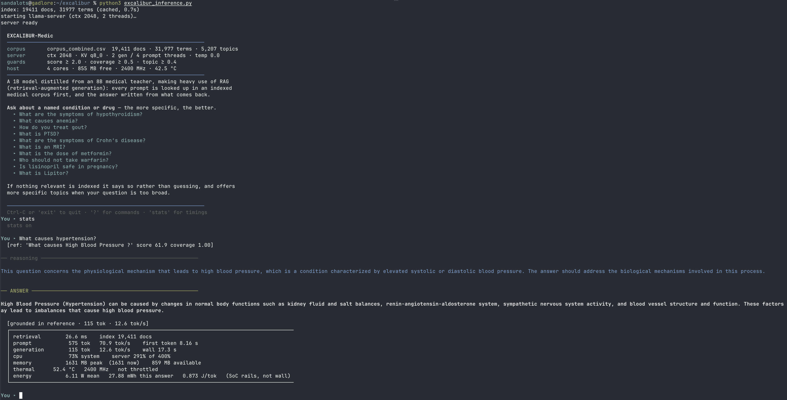
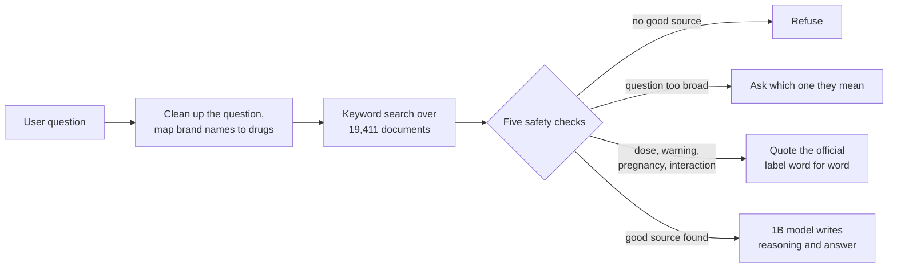

# EXCALIBUR-Medic
**Can distillation and retrieval enable on-device clinical inference on 2 GB edge devices?**

Sandy MacDonald ([ORCID 0009-0002-6153-7592](https://orcid.org/0009-0002-6153-7592)) · MSc Artificial Intelligence, University of Aberdeen (2026) · Supervisor: Dr Dewei Yi

[📄 Dissertation (PDF)](docs/report.pdf) · [▶ Video demonstration](https://drive.google.com/file/d/182-pbX9Y78gS9a8E_-rt8Ax0jTa4Y4sR/view?usp=sharing) · [Installation](INSTALLATION.md)

<p align="center">
  <a href="https://drive.google.com/file/d/182-pbX9Y78gS9a8E_-rt8Ax0jTa4Y4sR/view?usp=sharing">
    
  </a>
  <br>
  <sub>A live session on the Pi 5 with <code>stats</code> turned on. Finding the source took 27 ms, the answer was written at 12.6 tokens per second, memory peaked at 1.6 GB, and the board did not overheat. Click the image to watch the video demonstration.</sub>
</p>

EXCALIBUR-Medic is an offline medical reference that runs on a **Raspberry Pi 5 with 2 GB of
RAM**, a board that costs about £60. You ask it a question about a condition or a drug. It
finds the most relevant passage among 19,411 documents from the NIH, the FDA and MedlinePlus,
then a small 1-billion-parameter language model writes the answer from that passage. Nothing
is sent over the internet.

The model looks things up rather than answering from memory. When no suitable passage exists,
the system says so instead of guessing.

## Research question
Large AI models can now pass medical licensing exams, but they run on remote servers. That
makes them unusable wherever there is no reliable internet, where health data can't legally
leave the premises, or where paying per question isn't affordable. A model small enough for a
2 GB board can't store facts about thousands of conditions in its weights.

This project tests a way around that, in two parts:
- **Distillation:** a small 1B "student" model is trained to copy how a larger 8B medical
  "teacher" model reasons and answers. The aim is to transfer *behaviour*, such as answer
  structure, tone and knowing when to refuse.
- **Retrieval:** a search index supplies the *facts* at the moment a question is asked, so the
  model doesn't have to remember them.

## Key findings
- **Distillation and retrieval do different jobs.** Retrieval supplies the facts. Grounding,
  the share of an answer's words that can be traced to the source passage, rises from 0.31
  without retrieval to **0.705**. That is close to the 0.716 achieved when the model is handed
  the correct passage directly. Distillation supplies the structure: answers come out in the
  reasoning-then-answer format the rest of the system relies on **97.5%** of the time, against
  **0%** for the same 1B model before fine-tuning.
- **More training data didn't make the small model know more.** Going from 162 to 4,900
  training examples improved how well the model imitated the teacher's writing (validation
  perplexity fell from 3.14 to about 2.6), but grounding stayed flat at about 0.30. It learned
  the style of medical writing rather than the facts, which is why the facts come from
  retrieval instead.
- **Safety behaviour took very little data to teach.** 160 examples of refusing or asking a
  follow-up question (about 3% of the training data) were enough for the model to refuse **all 16**
  unseen questions it shouldn't answer, while wrongly refusing **none of 40** it should.
- **The cheapest changes gave the biggest gains.** The single largest improvement in finding
  the right document came from a simple pattern match that pulls the condition name out of the
  question. It added 8.9 percentage points of search accuracy.
- **It runs comfortably on the board.** It peaks at 1,638 MB of memory, writes about 14.6
  tokens (roughly 11 words) per second and draws about 5.4 W while answering. It never slowed
  down from overheating in any of the 40-minute stress tests.

## How it works


Search uses BM25, a standard keyword-ranking method. It needs no extra model, so it fits
alongside the language model in 2 GB of memory.

The language model never decides on its own whether to answer. Before it writes anything, five
checks on the search result decide whether a trustworthy source exists. They run in this order:

| Check | What it asks | What it prevents |
|---|---|---|
| Minimum score | Is the best search match strong enough? | Unrelated questions matching something by chance |
| Question coverage | Does the document account for the important words in the question? | A typo matching a different condition |
| Missing aspect | Does the source actually cover what was asked (the dose, the symptoms, …)? | The model making up content the source doesn't have |
| Too broad | Does the question name a whole category rather than one specific condition? | A general answer passed off as a specific one |
| Topic match | Is the document really about the subject of the question? | A confident answer built on an off-topic document |

Questions about doses, who shouldn't take a drug, warnings, side effects, interactions and
pregnancy skip the language model entirely. The answer is quoted word for word from the FDA
drug label, because paraphrasing that kind of information is a safety risk.

## Results
All model figures are reproduced by [`excalibur.ipynb`](excalibur.ipynb) and saved in
[`artifacts/plots/`](artifacts/plots/). Device figures come from
[`benchmark_pi.sh`](benchmark_pi.sh). Chapter 6 of the [dissertation](docs/report.pdf)
discusses both in full.

### Model and retrieval
The 40-question and 16-question tests use conditions and phrasings the model never saw during
training.

| What was measured | Result |
|---|---|
| Right document ranked first (1,200 test questions) | 49.2% → **88.2%** across five search improvements. A usable document was found for 100% |
| Grounding: no retrieval / with retrieval / given the correct passage | 0.314 / **0.705** / 0.716 |
| Answers in the required reasoning-then-answer format: original Llama-3.2-1B vs. distilled | 0 of 40 → **97.5%** |
| Grounding: original vs. distilled model, same search results | 0.473 → 0.602 |
| Refusals on unseen off-topic and personal questions | **16 of 16** refused, 0 of 40 answerable questions wrongly refused |
| Answers with numbers not found in the source / answers contradicting the source (n=40) | 1 of 40 / 0 of 40 |
| Realistic questions answered, across 16 categories | 64 of 71 (90%) |
| Teacher-written training examples that passed the quality filter | 5,485 of 6,000 (91.4%) |

*Grounding* measures how traceable an answer is to its source. It does not measure whether
the answer is medically correct (see [Limitations](#limitations)). A perfect score of 1.0 isn't
possible because the model rewords the source rather than copying it.

### On the device: Raspberry Pi 5 (2 GB, no screen, Raspberry Pi OS Lite)
Speed in tokens per second (a token is about three-quarters of a word), by number of CPU cores
used:

| CPU threads | Writing the answer | Reading the prompt |
|---|---|---|
| 1 | 9.6 | 21.9 |
| 2 | **14.6** | 44.3 |
| 3 | 13.7 | 63.4 |
| 4 | 12.7 | **77.7** |

Writing the answer is limited by memory speed, so it is fastest on 2 threads. Reading the
prompt is limited by processing power, so it keeps improving up to 4. The system uses 2
threads for writing and 4 for reading to get the best of both.

| What was measured | Result |
|---|---|
| Peak memory use, as deployed | 1,638 MB, leaving 929 MB free |
| Building / searching the index (pure Python on the Pi) | 3.3 s / 7.8 ms per search |
| Refusals, clarifications and word-for-word quotes | ~0.4 s, since the model isn't used |

| Power and temperature (two independent runs) | Run 1 | Run 2 |
|---|---|---|
| Idle, with the model loaded | 1.51 W | 1.50 W |
| Extra power for keeping the model loaded | −0.04 W | −0.01 W |
| Continuously answering questions | 5.38 W | 5.41 W |
| Typical energy per answer | 62.0 J | 61.4 J |
| Average power at 20 questions per hour | 1.85 W | 1.84 W |
| Slowdown from overheating over 40 minutes | none | none |

Power is read from the Pi's own power-management chip, so the true draw at the wall socket
is somewhat higher. The raw logs for every benchmark and energy run are in
[`measurements/`](measurements/), with earlier runs in
[`measurements/archive/`](measurements/archive/). All five complete energy runs there held
their speed for the full 40 minutes without overheating.

## Limitations
- **Traceable is not the same as correct.** Every model metric compares answers with their
  source text. No licensed clinician has reviewed the answers yet.
- **The test sets are small.** The safety evaluations use 40 answerable and 16 unanswerable
  questions.
- **The documents have gaps and are US-based.** About 1 in 10 realistic questions is refused
  because no document covers it, for example CT scans, vaccines and burns. The drug labels
  and emergency guidance follow US practice.
- **Search depends on how the documents are written.** The biggest search gain and one of the
  safety checks rely on questions that name their subject. They wouldn't work as well on
  free-form text.
- **One question at a time.** A follow-up like *"how do you get it?"* fails because the system
  doesn't remember the previous question.
- **Training needs an Apple Silicon Mac.** The training notebook uses Apple's MLX framework.
  The finished model file runs anywhere `llama.cpp` does.

## Future directions
- Have clinicians judge whether answers are medically correct, not just traceable.
- Better ways to measure faithfulness that handle rewording and contradictions.
- Remember the previous question while staying within 2 GB.
- A UK/EU version of the documents (BNF/EMA drug information, local emergency numbers).
- Try search that matches meaning rather than keywords, within the memory budget, and move
  training to PyTorch so it runs on any hardware.

## Repository
| File | What it does |
|---|---|
| [`excalibur.ipynb`](excalibur.ipynb) | Builds the model: the teacher writes training examples, a quality filter checks them, the student is fine-tuned (LoRA), then compressed to a 4-bit file for the Pi. Also produces every evaluation figure |
| [`excalibur_inference.py`](excalibur_inference.py) | The program that runs on the Pi: the documents, the search index, the five safety checks, word-for-word quoting, and the connection to the model server. Uses only Python's standard library |
| [`benchmark_pi.sh`](benchmark_pi.sh) | Measures the Pi: speed, peak memory, search cost, time per answer; `--energy` adds power use and a 40-minute heat test |
| [`docs/report.pdf`](docs/report.pdf) | The MSc dissertation |
| [`example_user_prompts.txt`](example_user_prompts.txt) | 25 example questions, checked to pass the safety checks and find the right document |

Supporting files: [`deploy_to_pi.sh`](deploy_to_pi.sh) copies everything to the Pi,
[`macintosh/mac_infer.sh`](macintosh/mac_infer.sh) runs the same program on the Mac,
[`scripts/`](scripts/) downloads and checks the documents, and [`reset.sh`](reset.sh) deletes
generated files.

### Models and data
| | |
|---|---|
| Teacher | `mlx-community/Llama3-OpenBioLLM-8B`, 4-bit (used for training only) |
| Student | `mlx-community/Llama-3.2-1B-Instruct-bf16`, fine-tuned with LoRA (11.3M trainable parameters, 0.9% of the model) |
| Deployed model | `excalibur-medic-1b-Q4_K_M.gguf`, 807 MB |
| Documents | MedQuAD (NIH question–answer pairs), openFDA drug labels, MedlinePlus health topics: 19,411 documents in total |

Training and test questions are split by condition, so no condition appears in both. The
combined document set and search index are built on the Pi the first time it runs, so neither
is stored in the repository.

## Getting started
Two machines are used: an Apple Silicon Mac builds the model, and a Raspberry Pi 5 (2 GB) runs
it. The model was built on a MacBook Pro M3 Pro (18 GB) and has also been tested on an M4 Mac
mini (16 GB). Full setup instructions, including building `llama.cpp`, are
in [`INSTALLATION.md`](INSTALLATION.md).

```bash
# on the Pi, after deploying
cd ~/excalibur

python3 excalibur_inference.py                      # interactive
python3 excalibur_inference.py --lite               # prompt only
python3 excalibur_inference.py -q "What is the dose of metformin?"
python3 excalibur_inference.py --stats              # show timings under each answer
```

In a session, `?` lists the commands, `stats` turns the timings on or off and `exit` quits.
[`example_user_prompts.txt`](example_user_prompts.txt) has 25 questions to try, covering
definitions, symptoms, causes, treatments, diagnosis, risk, inheritance, prevention and
outlook.

```bash
./benchmark_pi.sh            # speed, memory, search, time per answer
./benchmark_pi.sh --energy   # ~50 min: idle power, energy per answer, heat test
```

The trained model and its training data are too large for GitHub, so they are in a
[Google Drive folder](https://drive.google.com/drive/folders/1EAQRNXt1oq0X2fIOPTo2tkavDMHiOQ4O).
All of them are optional, because the notebook can regenerate each one:

| File | Size | Time saved | Put it in |
|---|---|---|---|
| `cot_full.jsonl` (teacher-written training examples) | 13 MB | ~11.6 h | `artifacts/synthetic/` |
| `sft_adapter.safetensors` (fine-tuned weights) | 43 MB | ~46 min | `artifacts/checkpoints/` |
| `excalibur-medic-1b-Q4_K_M.gguf` (the deployed model) | 807 MB | ~20 min | `artifacts/` |

## Citation
```bibtex
@mastersthesis{macdonald2026excalibur,
  author = {MacDonald, Sandy},
  title  = {{EXCALIBUR-Medic}: Can Distillation and Retrieval Enable On-Device Clinical Inference on 2 GB Edge Devices?},
  school = {University of Aberdeen},
  year   = {2026},
  type   = {MSc dissertation}
}
```

## Licence
The code is released under the [MIT Licence](LICENSE). The licence doesn't cover the data or
the dissertation:
- **MedQuAD** ([`datasets/medquad.csv`](datasets/medquad.csv)) is by Asma Ben Abacha and
  Dina Demner-Fushman, used under [CC BY 4.0](https://creativecommons.org/licenses/by/4.0/):
  [*A Question-Entailment Approach to Question Answering*](https://bmcbioinformatics.biomedcentral.com/articles/10.1186/s12859-019-3119-4),
  BMC Bioinformatics 20, 511 (2019).
- **openFDA** drug labels and **MedlinePlus** health topics are US government works, provided
  by the FDA and the National Library of Medicine respectively.
- **The dissertation** ([`docs/report.pdf`](docs/report.pdf)) is © Sandy MacDonald, all rights
  reserved.

## Disclaimer
This is a research prototype. It is not a medical device and does not give medical advice.
Its answers have not been clinically validated.
